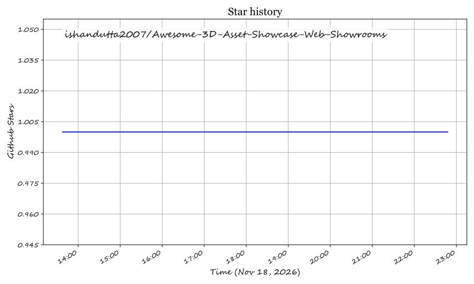

# Awesome-3D-Asset-Showcase-Web-Showrooms
# Awesome-3D-Asset-Showcase-Web-Showrooms

## Top 3D Asset Showcase & Web Showrooms Ecosystem

**Curated List of SaaS Products & Open-Source GitHub Projects**  
*Focused on Interactive WebGL/WebGPU 3D Viewers, Self-Hosted Galleries, Product Configurators & Virtual Showrooms*  
**Last updated: November 2026**

This repository tracks notable **SaaS platforms** and **open-source projects** for **3D Asset Showcase & Web Showrooms**. These tools enable artists, e-commerce brands, CAD/BIM engineers, and developers to publish, embed, inspect, customize, and present interactive 3D models directly in web browsers without plugins.

**Examples** include Sketchfab, Spline, Vectary, Verge3D, Clara.io, Marmoset Viewer, Threedy, PlayCanvas, Modelo, p3d.in, and my-name-is-jeff/vitrine (the category leaders). 

**Open-source emphasis**: This section is heavily expanded with every major active project for self-hosted 3D model galleries, zero-dependency `<model-viewer>` web components, CAD/BIM web viewers, and custom Three.js/Babylon.js/PlayCanvas showroom frameworks — ideal for 3D artists, e-commerce developers, museums, and studios building vendor-free web showcases.

Contributions welcome! Open a PR to add/update entries. Keep descriptions factual and link to official sites.

## Table of Contents
- [SaaS/Hosted Platforms](#saashosted-platforms)
- [Open-Source GitHub Projects](#open-source-github-projects)
- [How to Contribute](#how-to-contribute)
- [Disclaimer](#disclaimer)

## SaaS/Hosted Platforms

| Platform | Company Scale (Valuation / Revenue) | Pricing | Free Tier / Trial Limits | Description |
| :--- | :--- | :--- | :--- | :--- |
| **[Sketchfab](https://sketchfab.com/)** | **~$100M+ valuation** (Acquired by Epic Games for ~$100M+; ~$8M–$10M ARR) | **$15/month** (Pro plan starting tier; Premium at $79/mo) | **Free forever plan**: Up to 100 MB per model file upload, 10 annotations and 10 notes per model, public models only | Leading cloud-based 3D publishing, portfolio showcase, and marketplace platform with PBR rendering, post-processing filters, annotations, and WebXR support. |
| **[Spline](https://spline.design)** | **~$50M–$100M valuation** ($32M funding raised, incl. Series A; ~$4.7M ARR) | **$12/seat/month** (Hobby plan billed annually or $15/mo month-to-month; Pro at $25/seat/mo) | **Free forever plan**: Limited personal files, full access to templates & community library, public web exports include Spline watermark, 0 monthly AI credits | Collaborative browser-based 3D design and interactive web showroom tool enabling real-time physics, state events, and lightweight HTML/React embeds. |
| **[Threedy (instant3Dhub)](https://threedy.io)** | **~$50M–$100M valuation** ($12M+ funding raised, spin-off from Fraunhofer IGD) | **Contact sales for quote** (Enterprise usage-based licensing tiering by API token consumption in 5-minute slices across Visualization, Collaboration, & Enterprise packages) | **30-day (1-month) free trial**: Includes full access to instant3Dhub streaming capabilities and custom live onboarding demo; optional 4–6 week PoC | Enterprise spatial computing and industrial 3D streaming platform designed for rendering massive CAD datasets inside web showrooms and AR applications. |
| **[Vectary](https://www.vectary.com/)** | **~$37M valuation** ($14.4M funding raised; ~$3.2M ARR) | **$12/month** (Starter/Pro workspace plan starting tier) | **Free forever plan**: 1 user seat, 1 Starter workspace, max 5–10 active projects, 3,000 AI generation credits, public links/embeds include Vectary watermark | Cloud 3D design and product configurator studio built for interactive web embeds, Augmented Reality previews, and no-code e-commerce showcases. |
| **[PlayCanvas](https://playcanvas.com)** | **Multi-million exit** (Acquired by Snap Inc. in 2017) | **$15/month** (Personal plan starting tier; Organization plan at $50/seat/mo) | **Free forever plan**: 1 GB storage limit, unlimited public projects & unlimited collaborators, mandatory PlayCanvas loading screen/watermark, no self-hosting download | Cloud-hosted collaborative WebGL/WebGPU engine and visual editor widely used for building interactive virtual showrooms, automotive configurators, and web games. |
| **[Clara.io](https://clara.io)** | **~$10M+ prior scale** (Pivoted/rebranded to Threekit, raising $65M; legacy service retired) | **$10/month** (Standard plan prior starting tier; Advanced at $100/mo; service retired Dec 2022) | **Historical free plan**: Unlimited public scenes, 1 hour cloud rendering time/month, personal use (discontinued Dec 31, 2022) | Cloud-based 3D modeling, animation, and web rendering platform providing browser-native scene hosting and embeddable 3D viewers. |
| **[Modelo](https://modelo.io)** | **~$3.4M+ raised** (Seed-stage venture funding, later acquired by Kujiale) | **$16.58/month** (Pro plan billed annually at $199/yr, or $30/mo month-to-month; Team plan at $150/mo) | **Free forever plan / 14-day Pro trial**: Free plan includes 5 GB storage, 50 MB max model upload size, and 1 user seat; 14-day trial of Pro features | Cloud-based 3D architectural and CAD collaboration platform offering browser walkthroughs, section cuts, and client presentation rooms. |
| **[Marmoset Viewer](https://marmoset.co)** | **~$1.5M–$5M estimated revenue** (Established private software firm behind Toolbag) | **$18.99/month** (Toolbag Individual subscription; or $399 one-time perpetual license; Viewer runtime export is $0) | **30-day free trial**: 30-day time limit with 100% full feature access to all rendering/baking tools, zero watermarks on exports; requires online sign-in | WebGL rendering package exported from Marmoset Toolbag for showcasing high-fidelity game art, PBR materials, and wireframe/topology passes in browsers. |
| **[Soft8Soft (Verge3D)](https://soft8soft.com)** | **~$1M–$2M estimated revenue** (Bootstrapped profitable indie developer) | **$290 one-time** (Freelance perpetual license; Team license at $990; Enterprise at $2,990) | **Unlimited duration free trial**: Zero time limit / no expiration days, 100% full feature access, includes "Made with Verge3D Trial" watermark on exports until licensed | Artist-friendly 3D web toolkit that converts Blender, 3ds Max, and Maya scenes into interactive WebGL showrooms and configurators using visual Puzzles scripting. |
| **[p3d.in](https://p3d.in)** | **~$220k estimated ARR** (Independent boutique micro-SaaS) | **$6.67/month** (Plus plan billed annually; Premium at $50/mo; Enterprise at $333/mo) | **Free forever plan**: 100 MB total storage, 25 MB max file upload size, 5 unlisted models, basic embeds, strictly non-commercial use | Streamlined cloud 3D model sharing and presentation platform featuring an interactive material editor, studio lighting presets, and mobile-ready embeds. |

## Open-Source GitHub Projects

- **[Google `<model-viewer>`](https://github.com)**  
  Industry-standard open-source web component for easily displaying interactive 3D glTF/GLB models with PBR lighting, camera hotspots, and native WebXR/AR support (`Apache-2.0`).

- **[Online 3D Viewer (3dviewer.net)](https://github.com/kovacsv/Online3DViewer)**  
  Full-featured open-source web solution and JavaScript library for inspecting 20+ 3D and CAD formats (glTF, OBJ, FBX, STL, STEP, IFC, 3DM) directly in the browser (`MIT`).

- **[PlayCanvas Model Viewer](https://github.com)**  
  Official open-source 3D glTF/GLB and Gaussian Splat viewer powered by the PlayCanvas engine, featuring animation playback, environment lighting, and debug render modes (`MIT`).

- **[Manyfold](https://github.com)**  
  Self-hosted open-source digital asset manager and web gallery for organizing, tagging, sharing, and previewing 3D model collections in Three.js (`MIT`).

- **[Smithsonian Voyager](https://github.com)**  
  Open-source 3D explorer and museum storytelling showroom suite built by the Smithsonian Institution for annotated cultural heritage models, tours, and measurements (`Apache-2.0`).

- **[Three.js](https://github.com)**  
  The foundational open-source JavaScript 3D library powering custom WebGL/WebGPU product configurators, virtual galleries, and interactive web showrooms (`MIT`).

- **[Babylon.js](https://github.com)**  
  Powerful open-source TypeScript WebGL/WebGPU 3D engine featuring a built-in Sandbox viewer, Node Material Editor, and enterprise e-commerce showroom templates (`Apache-2.0`).

- **[Three.js Editor / glTF Viewer (donmccurdy)](https://github.com)**  
  Lightweight open-source drag-and-drop glTF 2.0 web viewer with PBR environment maps, skeleton inspection, and animation controls (`MIT`).

- **[NAVER egjs-view3d](https://github.com)**  
  Fast, customizable open-source glTF 3D model viewer supporting React, Vue, Angular, Svelte, annotations, and cross-platform AR sessions (`MIT`).

- **[Proton3DViewer](https://github.com/RunItBack1127/Proton3DViewer)**  
  Minimal, privacy-first open-source browser 3D viewer built with Vue, TypeScript, and Three.js supporting OBJ, PLY, glTF/GLB, STL, FBX, and 3DM (`MIT`).

- **[react-3d-model-viewer (3D-Viewer)](https://github.com/Omkarkumbhar47/3D-Viewer)**  
  Interactive open-source web-based 3D model inspector built with React Three Fiber featuring mesh part selection, visibility toggles, and high-res transparent snapshots (`MIT`).

- **[xeokit BIM Viewer](https://github.com)**  
  Open-source WebGL SDK and browser showroom viewer tailored for full-precision architectural BIM/IFC models, point clouds, and section planes (`AGPL-3.0`).

- **[A-Frame](https://github.com)**  
  Open-source declarative HTML web framework for building cross-platform 3D virtual showrooms and WebXR galleries that work on desktop, mobile, and VR headsets (`MIT`).

- **[Needle Engine](https://github.com)**  
  Web-based 3D runtime and exporter pipeline (with open-source components and web samples) for publishing interactive Blender and Unity scenes directly to the web.

- **[my-name-is-jeff/vitrine](https://github.com/my-name-is-jeff/vitrine)**  
  Open-source (`GPL-3.0`) Liquid Glass UI redesign project referenced alongside showcase ecosystems (note: specifically targets iOS Spotify UI theming rather than 3D web rendering).

### Additional Strong Open-Source Options

- **[React Three Fiber (R3F)](https://github.com)** and **[Drei](https://github.com)** for building declarative React 3D product showrooms, environment stages, and camera orbit controls.
- **[TresJS](https://github.com)** and **[Threlte](https://github.com)** for declarative 3D showcase components in Vue and Svelte ecosystems.
- **[ProductConfigurator-Threejs](https://github.com/ersurajsingh/ProductConfigurator-Threejs)** and **[3d-product-viewer](https://github.com/nomaanulhasan/3d-product-viewer)** for starter open-source e-commerce color/material swap showrooms.
- **[F3D](https://github.com)** and **[open3mod](https://github.com)** for fast, minimalist desktop 3D model inspection and batch thumbnail rendering.
- **[GaussianSplats3D](https://github.com)** and **[SuperSplat (PlayCanvas)](https://github.com)** for web-based 3D Gaussian Splatting photorealistic scene showcases.

**Frameworks for building custom systems**: Combine **Google `<model-viewer>`** or **Online 3D Viewer** with **React Three Fiber**, **Manyfold** (for self-hosted asset cataloging), and **SuperSplat** for end-to-end open-source 3D web showrooms.

## How to Contribute

1. Fork the repo.
2. Add/edit entries in `README.md` (follow existing format).
3. Include: name, link, 1–2 sentence description, and whether it's SaaS or open-source.
4. Submit PR with a short explanation.

Star the repo if you find it useful!

## Disclaimer

- This is a **community-curated** list — not exhaustive and not an endorsement.
- Large 3D assets (high-poly meshes and 4K/8K PBR textures) should be compressed using **Draco**, **Meshopt**, and **KTX2/Basis Universal** before deployment in web showrooms.
- Self-hosted 3D asset platforms require proper CORS configuration, CDN caching, and license verification for hosted third-party models.

---

**Made for 3D artists, e-commerce engineers, creative developers, and digital archivists.**  
Let's make 3D asset showcasing and web showrooms more open, fast, and accessible.

## ⭐ Star History

<a href="https://star-history.com/#ishandutta2007/Awesome-3D-Asset-Showcase-Web-Showrooms&Timeline" align="center">
  <picture>
    <source media="(prefers-color-scheme: dark)" srcset="assets/ishandutta2007_Awesome-3D-Asset-Showcase-Web-Showrooms_growth.svg">
    
  </picture>
</a>
